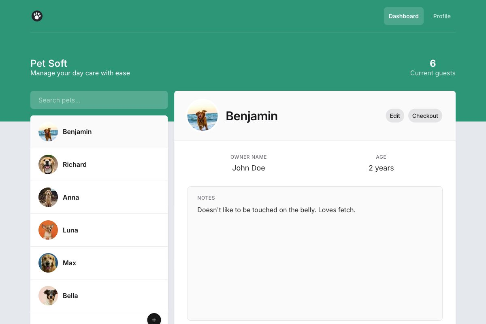

# PawK9

[](https://github.com/codewithsupra/pawk9/actions/workflows/ci.yml)

A pet-daycare dashboard. Daycares manage guests, check pets in and out, share photos with owners, and take paid bookings online.

**Live demo:** https://pawk9.vercel.app (Stripe and Clerk run in test mode, so no real money moves. Pay with card `4242 4242 4242 4242`.)



> It started from the ByteGrad "Petsoft" course project (pet list, add/edit/remove, search). Everything below was built on top of that: auth, billing, check-ins, photos, online booking and payments, and the move to production.

## What it does

- **Guests and stays.** Add, edit and search pets, with optimistic updates. Check pets in and out, with a visit history for each.
- **Photos for owners.** Upload photos, then email one to the owner as a link that expires after 7 days.
- **Online booking and payment.** Each pet gets a private booking link. Owners pick dates and pay by card, and the daycare is paid directly. PawK9 keeps an 8% platform fee.
- **Plans.** Subscription through Clerk Billing, or a one-time lifetime purchase through Stripe.

## Interesting engineering

**A booking is confirmed only by Stripe's webhook.** The page the owner returns to proves nothing, because anyone can open that URL. The webhook checks that the payment is paid, in USD and for exactly the stored amount. If a payment can't be honoured (the request was cancelled, another booking took the dates, or it is a duplicate), it is refunded in full, fee included, with an idempotency key so retries can't refund twice.

**No double-booking under concurrency.** Postgres runs transactions side by side, so a "check, then create" can pass twice at once. Check-in, booking requests and photo-send limits lock the owning row (`SELECT ... FOR UPDATE`) first, so the second request waits and sees the first one's result. A partial unique index (one open stay per pet) is the backstop. This was tested with 8 simultaneous check-ins, which produced exactly one stay.

**Every query is scoped to the signed-in user.** The data layer requires a `userId`, so an unscoped read can't be written. Server actions are public endpoints, so each one re-checks sign-in and plan access itself instead of trusting the page. Another user's pet looks the same as a missing one.

**Private photo storage.**

- Photos live in private Vercel Blob and are served only through an authenticated route.
- Uploads are validated by their real bytes: JPEG, PNG and WebP only, SVG refused, 3 MB cap.
- The browser re-encodes images first, which also strips GPS data.
- Photos sent to owners use HMAC-signed links that name one photo and expire.

**One validation source.** A single zod schema validates forms on the client and re-validates on the server, and the UI types are inferred from it.

## Stack

Next.js 16 (App Router, Turbopack, cache components), React 19, TypeScript, Tailwind CSS v4, shadcn/ui, Clerk (auth and billing), Prisma 7 on Postgres (Neon), Stripe (Checkout and Connect Express), Vercel Blob, Resend, zod, react-hook-form.

## Tests

`npm test` runs 75 unit tests (Vitest). The most important ones cover the payment webhook: confirming a booking, replayed deliveries, refunds for cancelled, overlapping and duplicate payments, and refusing wrong amounts or currencies. They run against an in-memory stand-in for the database and Stripe, and each was checked by breaking the real code to confirm the test fails. The others cover price maths, signed photo links, image-type detection, form validation and redirects. GitHub Actions runs lint, typecheck, formatting and the tests on every push.

## Run it locally

You need Node 24, Postgres, and accounts for Clerk, Stripe and Resend.

```bash
npm install
cp .env.example .env     # then fill in the values
npm run db:migrate       # create the tables
npx prisma generate
npm run dev
```

Sign in once, then run `npm run db:seed` to give your account sample pets. Forward Stripe webhooks locally with `stripe listen --forward-to localhost:3000/api/webhooks/stripe`.

More detail is in [DEPLOYMENT.md](DEPLOYMENT.md) (environment variables and the deploy checklist) and [CLAUDE.md](CLAUDE.md) (architecture notes).

## Known gaps

It is a test-mode deployment. Paid bookings can't yet be cancelled or refunded from the app, there is no error monitoring, and the Stripe connection status refreshes only when the daycare opens the Account page.
